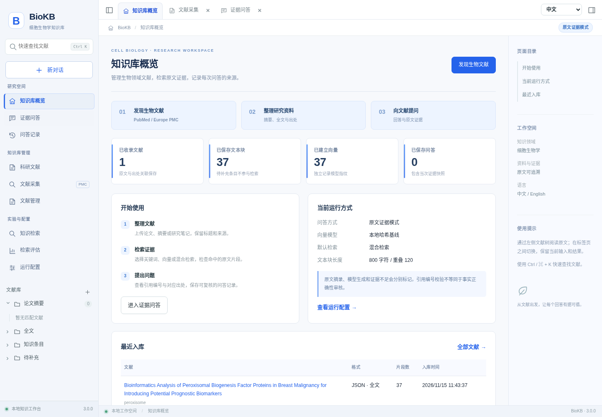

# BioKB · 细胞生物学知识库

**毕业设计：基于 RAG 技术的生物领域知识库系统研发。**

BioKB 面向细胞生物学的文献发现、知识管理与带证据问答。围绕细胞结构、细胞器、膜运输、细胞骨架、遗传信息传递及代谢等18个主题组织资料。系统采用 Python / Flask / SQLite 实现。



老师任务书的原文、实现与验收对应见[任务书对照](docs/任务书对照与验收.md)。

真实语义版已为134份资料建立8,083个多语言E5向量，支持本地CPU运行与中英术语补充。中文开发题的指定来源Hit@5由BM25的7/18提高到混合检索加术语补充的16/18；这不是回答准确率。实际记录与操作见[真实语义版运行与验收](docs/真实语义版运行与验收.md)。

早期开发验证已完成真实Embedding与本地大模型运行：7份资料、446个1024维向量片段、两轮各36份问答。结果与失败分析见[开发实验记录](docs/任务书开发实验记录.md)，[可选人工评分表](research/taskbook-dev-v2/review/盲评表.csv)保留为空，未生成该项评分结论。

知识库扩充版包含70篇综述与64个教材小节，覆盖18个主题。完整清单与重建命令见[扩充语料](research/cell-biology-expanded-v2/README.md)，扩充库真实索引与问答记录独立保存，未沿用7份资料上的实验成绩。扩充库12题试运行仍有误拒答和信息遗漏。当前采用[自动评测方案](docs/自动评测方案.md)，人工或专家评分不作为验收前置条件。

## 核心流程

1. **发现文献**：在 Europe PMC / PubMed 官方记录中按主题、标题摘要关键词和年份检索。
2. **建立知识库**：选择论文后核对 PMID、PMCID 与全文许可；支持开放全文、摘要和本地 TXT / PDF / DOCX / CSV / JSON。
3. **检索调试**：比较 BM25、向量、RRF 混合及重排序，查看原文片段和分数。
4. **证据问答**：多轮对话、论文范围限定、相邻证据扩展、出处定位与问答导出。
5. **实验评估**：冻结语料、自动检索指标、三组真实模型对照和证据区间覆盖诊断。人工评分入口可选，未填写不影响其他评测；事实质量自动裁判尚未接入。

## 安装与启动

需要 Python 3.10 或更高版本。

```bash
python -m venv .venv
# Windows PowerShell
.venv\Scripts\Activate.ps1
# macOS / Linux：source .venv/bin/activate
python -m pip install -e ".[dev]"
python app.py
```

浏览器访问 **http://127.0.0.1:5000**。Windows 安装依赖后也可运行 `start.bat`。首次启动为空库，在“文献采集”选择主题，再按需导入论文；在线检索需要网络，不需要模型密钥。

## 没有生物学资料时从哪里开始

**在线采集**：页面提供18个主题，可补充 `mitophagy`、`ATP`、`EGFR` 等英文关键词。优先选择题名和摘要与课题直接相关的综述，再补原始研究；搜索命中不等于人工确认相关。

也可独立建立一个开发库（每主题最多2篇，共最多36篇）：

```bash
python scripts/collect_biology.py --output data/cell-biology-starter --per-topic 2
python -m biokb --data-dir data/cell-biology-starter/database serve
```

命令拒绝覆盖已有目录，保存原始响应、XML 与来源摘要。仅在明确 CC BY / CC0 许可时自动导入全文，否则标明仅摘要。它不是专家审定的数据集。

**离线演示**：仓库附带两篇许可明确的真实文章正文样例与原始 XML，断网也能验证入库、分块、检索和原文定位：

```bash
python scripts/reproduce_demo.py --output data/open-demo
python -m biokb --data-dir data/open-demo/database serve
```

示例规模与范围仅用于复现流程，不作为论文效果结论。更多来源与筛选建议见[生物知识来源](docs/生物知识来源.md)。

## 配置真实模型

没有GPU时可使用本地E5 ONNX向量后端，配合兼容生成服务。模型核验、配置与命令见[真实语义版运行步骤](docs/真实语义版运行与验收.md)。

复制 `.env.example` 为 `.env`，配置 embedding、生成模型及可选的重排序接口。支持 Ollama 与 OpenAI 兼容服务。更换 embedding 后需要在独立副本中重建索引。

默认使用 **离线哈希向量 + 原文摘录**，不具备预训练语义模型能力。没有配置生成模型时不会把摘录伪装成大模型回答。配置方法见[开发与部署](docs/开发与部署.md)。

## 验证

```bash
python -m ruff check src/biokb tests/biokb scripts
python -m ruff format --check src/biokb tests/biokb scripts
python -m pytest -q
python scripts/audit_questionbank.py --output output/questionbank-audit
```

浏览器验证需先 `pip install -e ".[browser]"`，再 `python -m playwright install chromium`。命令与实际结果见[重构验收](docs/重构验收.md)。

本地真实模型、语料冻结与三组对照操作见[真实模型实验操作](docs/真实模型实验操作.md)。模型权重和正式数据库不随源码包分发。

## 目录

```text
src/biokb/       文献采集、入库、检索、问答、评估与 Web 工作台
tests/biokb/     当前主线测试；临时数据库与受控模型夹具
scripts/        当前采集、复现、评估和验证入口
docs/           架构、接口、来源、实验与验收文档
examples/       带许可与来源摘要的离线样例
config/         本地模型服务配置示例
research/       开发实验清单、机器摘要和可选评分材料
questionbank/   保留的冻结开发题与机器题，评价范围单独标记
deploy/         可选 Docker 部署配置
data/           运行数据与原文，默认不进入 Git
output/         本地实验和验证产物，默认不进入 Git
```

旧绘图、GraphRAG 研究材料及逐次历史验收已隔离到[归档分支](https://github.com/lambz1228/RAG-/tree/archive/pre-rebuild-20261115)，见[归档说明](docs/归档说明.md)。

[论文实验章节草稿](docs/论文实验章节草稿.md)仅记录已验证实现和开发实验，准确性与幻觉指标仍待真实评分。

## 论文与实现边界

当前适合单机、单实例演示；向量保存在 SQLite，进程内执行相似度计算。

来源可追溯、引用格式通过和检索命中，均不能单独证明生物学事实正确。82 道现有机器题没有人工复核记录；自动指标、模型裁判与可选人工评分需要分别记录，不以空白人工评分阻塞验收。相关方法见[实验设计](docs/实验设计.md)。

文献、依赖与模型的许可信息见[第三方许可与资料来源](THIRD_PARTY_NOTICES.md)。
