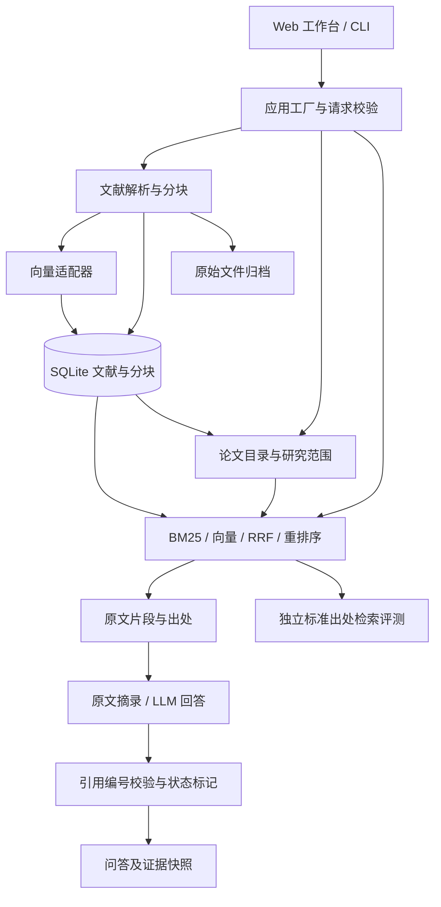

# 生物领域知识库系统架构

## 目标

选题：基于 RAG 技术的生物领域知识库系统研发。

面向生物领域文献和研究笔记，提供资料管理、双语检索、证据问答与评估。默认单机单用户运行，允许通过环境配置接入 Ollama 或 OpenAI 兼容的向量和生成接口。当前实现不包含多租户权限体系或生产级分布式任务调度。

## 模块与数据流

| 文件 | 职责 |
|---|---|
| `config.py` | 配置加载、值域校验、公开配置视图 |
| `storage.py` | SQLite 事务、文献、分块、向量、问答和评估记录 |
| `text.py` | NFC 规范化、英文词项/中文二元组、领域别名、分块偏移 |
| `ingestion.py` | 文档解析、SHA-256 去重、原始文件归档、迁移和索引 |
| `providers.py` | 离线哈希、Ollama/OpenAI 兼容向量与生成模型 |
| `quality.py` / `revisions.py` | 自动质量检查、筛选、只读原库并创建独立版本 |
| `papers.py` | 根据正式标识归并摘要与全文，解析限定论文范围；不改写旧文献编号 |
| `reranking.py` | 兼容 /rerank 服务、分数/索引校验及独立指纹 |
| `retrieval.py` | BM25、余弦相似度、RRF 排名融合与证据返回 |
| `rag.py` | 检索增强问答、引用校验、明确降级与历史快照 |
| `jobs.py` | 有界单进程执行器、SQLite 任务快照和重启恢复 |
| `evaluation.py` | 基于独立标准出处的文档级检索指标，以及冻结候选的论文级复算 |
| `container.py` | 依赖装配，支持测试注入 |
| `web/app.py` | 应用工厂、HTTP 接口、输入校验与错误映射 |
| `web/static/` | HTTP、通用组件、文献、研究功能和导航分离 |

## 存储设计

`documents` 保存原文、文件名、标题、来源元数据和原始文件哈希；`chunks` 保存文档外键、序号、原文片段、起止偏移；`embeddings` 保存分块外键、向量模型指纹、维度和归一化向量；`query_runs` 保存问答或评估的完整 JSON 快照；`app_meta` 保存结构版本和索引修订号；`jobs` 保存任务描述、状态和更新时间。单实例只运行一个服务进程，重启将 running/queued 标记为 interrupted，不自动重复调用模型。

文档删除通过外键级联清理分块与向量。问答保存证据文本快照，因此源文献移出知识库后历史回答仍可复核，原文详情入口则会提示文档不存在。原始归档文件不随文献删除而自动清理。

每次数据库操作创建独立连接，开启外键约束，使用 WAL 和连接超时。文献及索引在同一事务中写入。向量重建先完成全部模型调用，成功后检查索引修订号并事务替换，防止覆盖重建期间新增的数据。

## 检索与模型边界

BM25 使用英文词项、中文二元组与有限生物术语别名。向量检索采用归一化后的余弦相似度。混合检索以 RRF 融合两路排序，默认常数为 60，可配置候选数、融合常数和向量阈值；不同策略的原始得分不可当作同一概率解释。

默认哈希向量是可复现的离线基线，不具有预训练模型的完整语义能力。哈希召回额外要求词项重合，降低碰撞引起的无关结果。更换向量模型时必须重建索引；BM25 可独立使用。

生成模型只接收本次问题和选中的证据文本，不接收本地密钥或完整数据库。模型输出需为结构化 JSON，正文引用编号必须与引用列表及已召回证据一致。格式错误、服务失败或引用越界时回退原文摘录并返回原因。系统不声称通过这种校验即可证明回答事实正确。

问答证据正文默认限制为 24000 字符，由 `BIOKB_MAX_CONTEXT_CHARS` 配置。系统按检索排名保留能容纳的完整片段，达到限制时显示说明，快照中记录实际使用数量与长度；该数值不是模型 token 上限。可按原文偏移扩展前后相邻分块，保留召回中心定位；扩展不适合预算时回到原命中片段。模型还会接收问题、片段标题与系统提示词。

向量重建会检查跨批次维度及返回数量，异常时不写入部分索引。检索评估固定索引修订号；评估期间若有文献或索引变动，任务明确失败，避免将不同知识库版本混为同一次实验。

## 2.1 数据和生成约束

质量规则将短目录说明标为 `reference_stub`，保留资料但排除检索；其余内容仍标为未经人工审核。问答先召回候选，普通全库问题按每篇资料默认 2 个片段、80% 重叠阈值和字符预算选取完整证据；限定单篇论文时每资料可选至请求的 `top_k`，仍执行去重与预算约束。PDF 提供页范围，DOCX 按段落和表格原顺序解析并记录正文块。

## 2.2 论文与证据工作流

论文目录是从 `documents.metadata` 派生的读取视图，不引入新表，也不改写历史 `source_id`。按一致的 PMID、PMCID、DOI 合并摘要与全文；同名或冲突标识不自动合并。检索入口先解析 `paper_ids`，再和主题、年份、资料类型筛选取交集，问答保存当次范围快照。无效或失效编号直接报错。数据库继续按资料和分块保存原文，论文目录层只负责身份与范围，不承担人工学术审查。

生成 JSON 需包含 status、answer、citations。兼容服务可显式启用 json_object；这只能约束 JSON 语法，仍需校验字段和引用。首次结构校验失败可请求一次格式纠正，保留错误和两次响应摘要；第二次仍失败则回退原文。answered/partial 必须引用，insufficient 可返回空引用。事实蕴含不由结构检查证明。

查询向量缓存限制 128 条，仅在同一个固定模型实例中复用，重启清空。实验保存语料内容摘要与索引指纹；共享缓存下的策略延迟不构成独立速度比较。

## 与旧项目的关系

新的主线不导入旧绘图编排模块。`import-legacy` 读取已有生物语料文件，将来源元数据和内容导入独立数据库。旧 GraphRAG 索引和原始实验脚本保留，用于历史追溯或后续对照研究；当前主线四种策略中不包含 GraphRAG。
