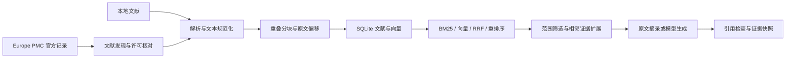

# 架构设计

系统面向单机细胞生物学知识工作台。后端采用 Flask 应用工厂、SQLite 持久化和依赖注入，前端使用原生 JavaScript 模块与响应式 CSS。界面参考 MimirQ 的导航、知识管理和证据阅读流程，未引入其企业权限、多服务依赖或通用工作流平台。

| 模块 | 职责 |
| --- | --- |
| `config.py` | 配置读取、边界与公开配置，密钥字段不公开 |
| `literature.py` | 固定官方 API、六类主题、来源身份与许可核对 |
| `ingestion.py` / `text.py` | 多格式解析、去重、分块与原文位置 |
| `storage.py` / `papers.py` | 数据持久化、论文身份归并、范围解析 |
| `providers.py` / `reranking.py` | 向量、生成和重排序适配，超时与降级 |
| `retrieval.py` / `rag.py` | 检索、证据选取、结构校验和问答快照 |
| `evaluation.py` / `experiments.py` | 检索指标、问答对照和盲评材料 |
| `jobs.py` | 进程内有界任务、最近状态持久化 |
| `web/` | 路由、工作台、双语与移动端 |

向量在 SQLite 保存，在进程内执行余弦相似度；更换向量指纹时拒绝混用旧索引。后台任务不支持多进程协调，重启未完成任务会标记中断。资料规模扩大后的 ANN 索引、队列和权限体系属于后续工作，不作为当前实现宣称。
